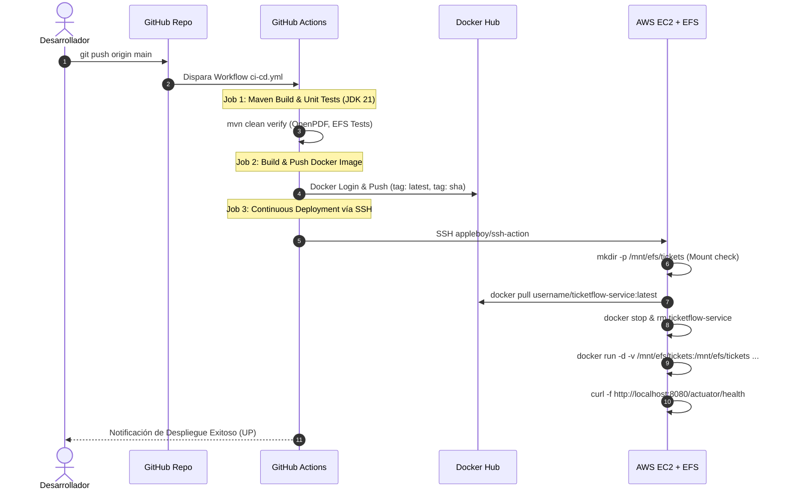

# Documento de Arquitectura Cloud Native: TicketFlow Service
**Asignatura:** Desarrollo Cloud Native (CDY2204)  
**Institución:** Duoc UC  
**Evaluación:** Semana 3 - Sumativa *"Construyendo y desplegando una solución Cloud Native"*  
**Autor:** Víctor Lind

---

## 1. Visión General del Sistema

El sistema implementa una arquitectura de microservicios basada en el patrón **Dual Storage Cloud-Native**, diseñada para una startup de eventos de alta concurrencia que requiere emisión instantánea de tickets en PDF con código QR, almacenamiento temporal de alto rendimiento (Amazon EFS) y persistencia duradera, distribuida y escalable (Amazon S3).

```
                      +-----------------------------+
                      |       CLIENTES / API        |
                      |   (Postman / Swagger UI)    |
                      +--------------+--------------+
                                     |
                                     v
                      +-----------------------------+
                      |   MICROSERVICIO TICKETFLOW  |
                      |  (Spring Boot 3 + Java 21)  |
                      +-------+--------------+------+
                              |              |
          [Almacenamiento     |              |    [Persistencia
            Temporal EFS]     |              |     Duradera S3]
                              v              v
               +------------------+   +--------------------+
               |    Amazon EFS    |   |     Amazon S3      |
               | (/mnt/efs/tickets|   | /{eventoId}/       |
               |  NFS Compartido) |   |  {usuarioId}/      |
               +------------------+   |  {ticketId}.pdf)   |
                                      +--------------------+
```

---

## 2. Decisiones Arquitectónicas Clave (ADRs)

### 2.1 Estrategia de Almacenamiento Multinivel (Storage Tiering)

| Nivel | Componente AWS | Propósito | Características Técnicas |
| :--- | :--- | :--- | :--- |
| **Tier 1 (Temporal)** | **Amazon EFS (Elastic File System)** | Generación y procesamiento temporal de PDFs con baja latencia | - Protocolo NFSv4.1 montado en `/mnt/efs/tickets`<br>- Acceso concurrente POSIX multi-instancia<br>- Organización jerárquica: `/{eventoId}/{usuarioId}/` |
| **Tier 2 (Definitivo)** | **Amazon S3 (Simple Storage Service)** | Almacenamiento definitivo, auditoría y distribución de tickets | - Objeto inmutable o versionado con clave: `{eventoId}/{usuarioId}/{ticketId}.pdf`<br>- Resiliencia 99.999999999% (11 9's)<br>- Descarga directa vía HTTP Streaming o Pre-signed URLs |
| **Metadatos** | **PostgreSQL / H2 (JPA)** | Catálogo de eventos, estado de tickets y auditoría de operaciones | - Índices por evento, usuario, estado y fecha<br>- Historial transaccional (`ticket_history`) |

### 2.2 Principios Cloud Native (The Twelve-Factor App)
1. **Base de Código Única:** Repositorio Git centralizado que versiona la infraestructura y el microservicio.
2. **Dependencias Explícitas:** Gestión declarativa de dependencias en `pom.xml`.
3. **Configuraciones en el Entorno:** Separación estricta de configuración y código (`application.yml` parametrizado con variables de entorno: `AWS_REGION`, `AWS_S3_BUCKET`, `EFS_MOUNT_PATH`).
4. **Respaldos de Servicios (Backing Services):** EFS, S3 y la base de datos se consumen como recursos vinculados mediante endpoints configurables.
5. **Construir, Distribuir, Ejecutar:** Pipeline automatizado en GitHub Actions que genera artefactos inmutables (Docker Hub).
6. **Procesos Sin Estado (Stateless):** El microservicio delega todo estado a EFS, S3 y la base de datos.
7. **Asignación de Puertos:** El microservicio expone el puerto 8080 autónomamente.
8. **Concurrencia:** Escalado horizontal simple ejecutando réplicas que comparten el mismo montaje EFS y bucket S3.
9. **Desechabilidad:** Inicio rápido y apagado seguro (`graceful shutdown`).
10. **Paridad Desarrollo/Producción:** Emulación idéntica local mediante LocalStack (S3) y volúmenes Docker (EFS).
11. **Registros (Logs):** Registro estructurado de eventos hacia `stdout` recolectable por CloudWatch o Docker.
12. **Procesos de Administración:** Endpoints administrativos expuestos bajo `/actuator`.

---

## 3. Especificación de Endpoints REST

| Método | Endpoint | Descripción | Criterio Rúbrica |
| :--- | :--- | :--- | :--- |
| `POST` | `/api/v1/tickets/generate` | Genera PDF en EFS temporal y sube automáticamente a S3 | **Criterio 1 y 2** |
| `POST` | `/api/v1/tickets/{id}/upload-s3` | Sube o re-sincroniza manualmente un ticket a S3 | **Criterio 2** |
| `GET` | `/api/v1/tickets/{id}/download` | Descarga el PDF en streaming desde S3 (`application/pdf`) | **Criterio 4** |
| `GET` | `/api/v1/tickets/{id}/presigned-url` | Genera URL prefirmada de S3 para descarga segura y directa | **Criterio 4** |
| `PUT` | `/api/v1/tickets/{id}` | Modifica datos del ticket, regenera PDF y actualiza en S3 y EFS | **Criterio 3** |
| `DELETE` | `/api/v1/tickets/{id}` | Elimina el ticket y purga los archivos en S3 y EFS | **Requisito 3** |
| `GET` | `/api/v1/tickets/history` | Consulta historial de archivos generados con filtros (fecha, usuario, evento) | **Criterio 5** |
| `GET` | `/api/v1/events/{eventCode}/stats` | Reporta estadísticas de venta, reservas y almacenamiento por evento | **Requisito 3** |
| `GET` | `/api/v1/tickets/download/user/{userId}` | Descarga empaquetada (ZIP) de tickets por usuario | **Requisito 3** |
| `GET` | `/api/v1/tickets/download/event/{eventCode}` | Descarga empaquetada (ZIP) de tickets por evento | **Requisito 3** |
| `GET` | `/actuator/health` | Health Check operativo para monitoreo y pipeline CI/CD | **Criterio 6** |

---

## 4. Pipeline de CI/CD (GitHub Actions)



---

## 5. Matriz de Cumplimiento de la Rúbrica de Evaluación

| N° | Criterio de la Rúbrica | Puntaje | Implementación Técnica | Nivel de Logro |
| :---: | :--- | :---: | :--- | :---: |
| **1** | Configura el almacenamiento temporal en EFS | 15 pts | - `EfsStorageService.java` gestiona `/mnt/efs/tickets/{eventoId}/{usuarioId}/`<br>- Montaje verificado en Docker y script `setup_ec2_efs.sh` | **CL (100%)** |
| **2** | Sube los archivos generados a AWS S3 | 10 pts | - Subida automática al generar ticket con clave `/{eventoId}/{usuarioId}/{ticketId}.pdf`<br>- Metadatos de auditoría y checksum SHA-256 | **CL (100%)** |
| **3** | Modifica y actualiza los archivos en AWS S3 | 15 pts | - Endpoint `PUT /api/v1/tickets/{id}` regenera PDF y sobrescribe el objeto en S3 preservando clave y actualizando metadatos | **CL (100%)** |
| **4** | Descarga los archivos desde AWS S3 | 10 pts | - Streaming binario en `GET /api/v1/tickets/{id}/download`<br>- Pre-signed URLs en `GET /api/v1/tickets/{id}/presigned-url`<br>- Bulk ZIP por usuario y por evento | **CL (100%)** |
| **5** | Consulta el historial de archivos generados | 10 pts | - Endpoint `GET /api/v1/tickets/history` con filtros dinámicos (fecha inicio/fin, usuario, evento, acción) y paginación | **CL (100%)** |
| **6** | Despliega la aplicación mediante pipeline automatizado | 20 pts | - `.github/workflows/ci-cd.yml` con 3 jobs: Tests, Docker Hub Push y SSH Deploy en EC2 con volumen EFS montado | **CL (100%)** |
| **7** | Presenta la solución mediante video explicativo | 20 pts | - Guion estructurado `GUIA_GRABACION_PRESENTACION.md`<br>- Colección Postman con tests automáticos `TicketFlow_API.postman_collection.json` | **CL (100%)** |
| **TOTAL** | **Calificación Final Esperada** | **100 pts / 100%** | **Cumplimiento Completo y Riguroso** | **CL (100%)** |
